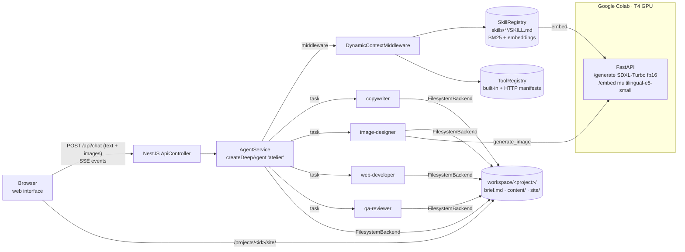

# Response — Multi-Agent / Multi-Modal Collaborative Research and Development

**Project:** *Atelier*, a deep agent that designs and builds corporate websites (text + generated images) from a brief and reference images.

- **Repository:** https://github.com/Youssefkhal/prg2-website-agent
- **Demo website (GitHub Pages):** https://youssefkhal.github.io/prg2-website-agent/
- **Assignment:** [`multi_agent_multimodal_collaborative_research_and_development.md`](multi_agent_multimodal_collaborative_research_and_development.md)

---

## 1. Summary

Atelier is a **LangChain `deepagents`** agent served by a **NestJS (TypeScript)** backend with a **web interface**.
The user describes a company and can attach images (logo, photos, moodboard). The main agent analyses the images, plans
the work, and delegates to four specialised **sub-agents** (copywriter, image designer, web developer, QA reviewer). Together
they produce a complete static corporate website with its copy and its images.

Two design points answer the hardest parts of the assignment:

1. **Dynamic skills and tools.** The skill library can hold thousands of skills, but **none is placed in the model context by default**.
   On each model call, a middleware retrieves the few skills relevant to the current request. The agent loads more on demand, and tools are
   bound to the model only when a loaded skill (or the agent itself) asks for them. Skills and tools can be added **at runtime**
   without a restart.
2. **GPU work on a Colab T4.** Text-to-image generation (SDXL-Turbo) and semantic embeddings for skill retrieval run on a
   FastAPI server inside a Google Colab T4 notebook. A Cloudflare tunnel exposes it to the backend.

---

## 2. Requirements → implementation

| # | Requirement | Implementation | Where |
|---|---|---|---|
| 1 | Use LangChain `deepagents` for extended reasoning | `createDeepAgent()` (deepagents JS ≥ 1.16): planning with `write_todos`, virtual filesystem, `task` sub-agent delegation, LangGraph checkpointer for multi-turn memory, recursion limit 400 for long tasks | `backend/src/agent/agent.service.ts` |
| 2 | Prefer TypeScript → NestJS | The entire backend is TypeScript / NestJS 11 | `backend/src/` |
| 3 | If Python → FastAPI | The only Python component (GPU server) is FastAPI | `colab/gpu_server.py` |
| 4 | Web interface | Chat with SSE streaming, image attach (button, drag & drop, paste), live site preview, file browser, plan (todos) and sub-agent activity, skill search, runtime skill/tool registration | `backend/public/` |
| 5 | Skill, tool and sub-agent invocation | `search_skills` / `load_skill`; tools `generate_image`, `generate_color_palette`, `audit_website`, HTTP tools; 4 sub-agents through `task` | `dynamic-context.middleware.ts`, `tool-registry.ts`, `agent.service.ts` |
| 6 | Dynamic registration of tools and skills (only needed skills in context) | `DynamicContextMiddleware`: per-call retrieval (BM25 + GPU embeddings), progressive loading, tools bound only when needed, hot reload, `POST /api/skills`, `POST /api/tools` | `backend/src/agent/`, `backend/src/skills/`, `backend/src/tools/` |
| 7 | Multimodal: images and text as input | Images are sent as `image_url` content blocks to a multimodal model and saved in the project (`/site/assets/uploads/`) so the site can use them | `agent.service.ts`, `public/app.js` |
| D | Deliverable: create a corporate website with images and text together | 4 sub-agents produce `/brief.md` → `/content/*.md` → `/site/*.html` + CSS/JS + images generated on the Colab T4; QA audit loop. Demo: Verdance site | `demo/`, GitHub Pages |
| + | All GPU computation on Colab T4 | Image generation + embeddings in `gpu_server.ipynb`; the backend never needs a local GPU | `colab/` |

---

## 3. Architecture



### 3.1 Agents

| Agent | Role | Specific tools |
|---|---|---|
| **atelier** (main) | Reads the brief and the images (brand colours, style), writes `/brief.md`, plans with `write_todos`, delegates, verifies, reports | dynamic tools, `task` |
| **copywriter** | All page copy (titles ≤ 60 chars, meta descriptions, headings, CTAs, alt texts) → `/content/*.md` | skills (copywriting, SEO) |
| **image-designer** | Art direction + English SDXL prompts, sizes and consistent style → `generate_image` on the Colab T4 → `/site/assets/images/` | `generate_image` |
| **web-developer** | Semantic, responsive, accessible static site in `/site` from the brief, copy and images | `generate_color_palette` (via skill) |
| **qa-reviewer** | Runs `audit_website`, fixes every error (broken links, alt, meta, h1…), re-audits | `audit_website` |

Sub-agents run in **isolated contexts** (deepagents' `task` tool). They cannot see the user's images, so the main agent writes its visual
analysis into `/brief.md`. This shared file is how they collaborate.

### 3.2 Models

| Purpose | Default model | Runs on |
|---|---|---|
| Reasoning, vision, writing and code (all agents) | `anthropic:claude-sonnet-4-6`, configurable with `MODEL` (any multimodal, tool-calling LangChain model, e.g. `openai:gpt-4.1`); optional cheaper `SUBAGENT_MODEL` | Provider API |
| Text-to-image | `stabilityai/sdxl-turbo` (fp16, with the fp16-fixed VAE), 1–4 steps | **Colab T4** |
| Skill retrieval embeddings | `intfloat/multilingual-e5-small` (French + English) | **Colab T4** |

---

## 4. Dynamic registration of skills and tools

### 4.1 The problem
With 1,000 local skills, putting even their names and descriptions in the system prompt costs tens of thousands of tokens on every
call and dilutes the model's attention. deepagents' built-in skills middleware lists every skill, so Atelier uses its own retrieval layer
built on LangChain's documented middleware hooks (`wrapModelCall` / `wrapToolCall`).

### 4.2 How it works (`DynamicContextMiddleware`)
On **every model call** (main agent and each sub-agent):

1. **Retrieve.** The latest user request is matched against the skill index. Only the top 4 skills (name + one line) are injected,
   under "Suggested for the current request".
2. **Load on demand.** The agent calls `load_skill(name)` to read the full `SKILL.md`, or `load_skill(name, file)` for one of the skill's resources.
   For anything else it calls `search_skills(query)`.
3. **Derive state from the conversation.** Loaded skills and enabled tools are read from the message history (the `load_skill` /
   `enable_tools` tool calls). The state therefore survives checkpoints and disappears if the conversation is compacted.
4. **Bind tools lazily.** A skill declares the tools it needs (`tools: [generate_image]` in its frontmatter). Those tools, plus any enabled
   with `search_tools` → `enable_tools`, are added to `request.tools` for that call only. The model never sees other tool schemas.
5. **Execute dynamic tools.** `wrapToolCall` supplies the implementation of tools that were not registered when the agent was created.
   This is LangChain's documented pattern for dynamically registered tools, so tools added at runtime work **without rebuilding the agent**.

```
System prompt addition (example, 1,012 skills installed):
## Skills & dynamic tools
A library of 1012 skills exists but is NOT listed here. Use search_skills / load_skill.
Suggested for the current request:
- corporate-website-architecture: Plan the sitemap, page structure and user journeys…
- image-prompting-sdxl: Write effective prompts for SDXL / SDXL-Turbo…
- brand-copywriting: …   - logo-and-brand-extraction: …
Already loaded in this conversation: corporate-website-architecture
Dynamic tools currently bound: generate_image. Others (4 total) can be found with search_tools…
```

### 4.3 Retrieval
- **BM25** (CPU, dependency-free, French/English normalisation and light stemming) is always available. Search over 1,012 skills takes a few milliseconds.
- **Semantic.** Skill embeddings are computed **on the Colab T4** in batches and cached on disk (`.cache/skill-embeddings.json`, keyed by content hash).
  Queries are embedded on the GPU and cached. Final score = 0.5 × normalised BM25 + 0.5 × cosine. If Colab is offline, search falls back to BM25 alone.

### 4.4 Runtime registration

| What | How |
|---|---|
| New skill | Drop a folder with `SKILL.md` under `backend/skills/` (file watcher, re-indexed in ~0.5 s), or `POST /api/skills`, or the form in the UI |
| New tool | Drop a JSON manifest in `backend/tools/` (HTTP tool: URL template, method, JSON-Schema parameters), or `POST /api/tools`, or the form in the UI. Example: `tools/wikipedia_summary.json` |
| Scale test | `npm run skills:demo` generates 1,000 extra skills; context size per call stays the same |

---

## 5. Multimodal input

- The UI accepts images through the attach button, drag & drop or paste. They are downscaled client-side to ≤ 1568 px (PNG kept for logo transparency).
- The backend stores each image in the project (`/site/assets/uploads/<name>.<ext>`) and sends the message as
  `[{type:"text"}, {type:"image_url", image_url:{url:"data:…"}}…]` to the multimodal model, together with the saved paths.
- The main agent extracts brand colours (hex), typography cues and mood, records them in `/brief.md`, calls
  `generate_color_palette` for an accessible palette, and reuses the real logo in the header and footer. The image model is never asked to draw logos or text.

---

## 6. GPU on Google Colab (T4)

`colab/gpu_server.ipynb` (the same code is in `gpu_server.py`):

| Endpoint | Model | Details |
|---|---|---|
| `POST /generate` | SDXL-Turbo fp16 + `madebyollin/sdxl-vae-fp16-fix` | sizes snapped to multiples of 64 (256–1024), 4 steps, guidance 0, seed returned; a few seconds per image on a T4 (more on the first call, while the model loads) |
| `POST /embed` | multilingual-e5-small (fp16) | `query:` / `passage:` prefixes, normalised vectors, batch 64 |
| `GET /health` | — | device, GPU name, VRAM, loaded models |

- One GPU lock serialises jobs so the 16 GB T4 never runs two at once. Calls are authenticated with an `x-api-key` token generated at start-up.
- A **Cloudflare quick tunnel** (no account needed) publishes the server. The notebook prints `COLAB_GPU_URL` and `COLAB_GPU_TOKEN` for `backend/.env`.
- **Graceful degradation.** Without Colab, `generate_image` writes labelled SVG placeholders and skill search uses BM25 only, so the pipeline never blocks.

---

## 7. Web interface

| Area | Content |
|---|---|
| Top bar | Colab GPU status (GPU name or offline), model, number of skills and index type, project switcher, new project |
| Chat | Streaming tokens; each bubble is labelled with the agent that wrote it (main or sub-agent, indented). Tool calls appear as collapsible cards with arguments and results. Generated images get a thumbnail. |
| Preview | Live iframe of `/site/*.html` with a page selector, refreshed when files change; "Open ↗" opens it in a new tab |
| Files | Every project file (brief, content, site, images), with a viewer |
| Plan | The agent's `write_todos` list (pending / in progress / done) and a sub-agent activity log |
| Skills & tools | Hybrid skill search with scores, register a skill, list and register HTTP tools |

API: `POST /api/chat` (SSE: `token`, `tool_call`, `tool_args`, `tool_result`, `uploads`, `done`, `error`), `GET /api/health`,
`GET|POST /api/skills`, `GET|POST /api/tools`, `GET /api/projects/:id/{files,file,history}`, static preview at `/projects/:id/site/`.

---

## 8. Deliverable — corporate website

**Demo:** *Verdance* (fictional company), an energy-transition consultancy for SMEs in Lyon.
Input: [`demo/brief-prompt.md`](demo/brief-prompt.md) (text) + [`demo/inputs/logo.svg`](demo/inputs/logo.svg) (image).

| Page | Content |
|---|---|
| `index.html` | Hero with promise and two CTAs, key figures, 4 service cards with images, 4-step method, testimonial (marked fictional), FAQ, CTA band |
| `services.html` | One section per service (audit, solar, renovation, funding), each with an illustration, benefits and a CTA |
| `a-propos.html` | Story, values, team |
| `contact.html` | Accessible form with GDPR consent, contact card, map link |
| `mentions-legales.html` | Legal notice, privacy policy (GDPR), cookies; legal identifiers left as `[à compléter]` |

Quality: semantic HTML5, `lang="fr"`, skip link, one `h1` per page, alt text on every image, responsive mobile-first CSS with a mobile menu,
brand palette taken from the logo, WCAG-AA contrast, Open Graph tags, lazy loading. It passes the agent's own `audit_website` tool with
**0 errors and 0 warnings**.

**Live:** https://youssefkhal.github.io/prg2-website-agent/

> **Transparency.** The site in `demo/site/` is a *reference output*. It was written by hand following exactly the brief, sitemap, skills and
> file layout the agent uses, because the agent could not be executed in the environment where this repository was prepared (no package
> registry access, no LLM key, no GPU). For the same reason, its illustrations are hand-made SVGs rather than SDXL images.
> The workflow **"Generate demo site with the agent"** runs the real agent headless on the same input and commits the result to
> `demo/agent-run/`, published at `/agent-run/`. It needs the `ANTHROPIC_API_KEY` repository secret, plus `COLAB_GPU_URL` / `COLAB_GPU_TOKEN` for real images.

---

## 9. Running it

```bash
# 1) GPU — open colab/gpu_server.ipynb in Colab, Runtime → T4 GPU, run all cells, copy the 2 printed lines
# 2) Backend + UI (Node ≥ 20)
cd backend
npm install
cp .env.example .env          # set ANTHROPIC_API_KEY (or OPENAI_*), COLAB_GPU_URL, COLAB_GPU_TOKEN
npm run build && npm start    # → http://localhost:3000
# Windows: double-click backend/run.bat (install, build, test, start, open browser)

# Optional
npm run skills:demo           # +1,000 skills to test scaling
npm test                      # unit tests
npm run demo -- --brief ../demo/brief-prompt.md --images ../demo/inputs --out ../demo/agent-run   # headless run
```

---

## 10. Testing and CI

| Check | How |
|---|---|
| Unit tests (6) | frontmatter parsing, skill retrieval relevance (FR/EN), runtime skill registration, conversation scan for loaded skills and enabled tools, palette contrast ≥ 4.5:1, site audit detection |
| CI (`.github/workflows/ci.yml`) | `npm install` → TypeScript build → unit tests → boots the server with 1,012 skills and calls `/api/health`, `/api/skills`, `/api/tools` and the UI; compiles the Colab server and validates the notebook |
| Site audit | `audit_website` on `demo/site`: 5 pages, 0 errors, 0 warnings |
| UI | rendered with Playwright on simulated agent events (streaming, tool cards, sub-agent labels, todos, preview) |
| End-to-end agent run | `generate-demo.yml` workflow (requires an LLM API key secret) |

---

## 11. Limitations and next steps

- **Memory.** Conversation state uses LangGraph `MemorySaver` (in memory). A restart loses chat history but keeps the project files. Next step: a SQLite or Postgres checkpointer.
- **Image model licence.** SDXL-Turbo is licensed for non-commercial use. For production, set `IMAGE_MODEL_ID` to a commercially licensed model that fits a T4.
- **Colab sessions are ephemeral.** The tunnel URL changes on every restart and must be copied into `.env`.
- **Static sites only.** The agent builds static HTML/CSS/JS. Forms are demo-only (mailto or form-service placeholder).
- **Generated legal pages are templates** and must be validated by a lawyer.
- **Next ideas:** a vision check of generated images (the model reviewing its own outputs), a ZIP export, one-click deployment of generated sites, human approval before publishing.

---

## 12. Repository map

```
.
├── RESPONSE.md                     ← this document
├── README.md                       ← quick start (FR)
├── multi_agent_multimodal_…md      ← the assignment
├── .github/workflows/              ← ci.yml · pages.yml · generate-demo.yml
├── backend/                        ← NestJS + deepagents
│   ├── src/agent/                  ← agent.service, dynamic-context.middleware, prompts, conversation-scan
│   ├── src/skills/                 ← SkillRegistry (index, hot reload, register)
│   ├── src/tools/                  ← ToolRegistry, built-in tools, HTTP manifests, web utils
│   ├── src/retrieval/bm25.ts       ← lexical index
│   ├── src/gpu/colab-client.ts     ← Colab T4 client
│   ├── src/api/api.controller.ts   ← REST + SSE
│   ├── src/cli/demo.ts             ← headless run
│   ├── public/                     ← web interface
│   ├── skills/core/                ← 12 skills (+ scripts/generate-demo-skills.mjs for 1,000)
│   ├── tools/                      ← runtime tool manifests
│   ├── test/                       ← unit tests
│   └── run.bat                     ← Windows one-click launcher
├── colab/                          ← gpu_server.ipynb / gpu_server.py (FastAPI, T4)
└── demo/                           ← Verdance: input, brief, site (Pages), agent-run (workflow output)
```
